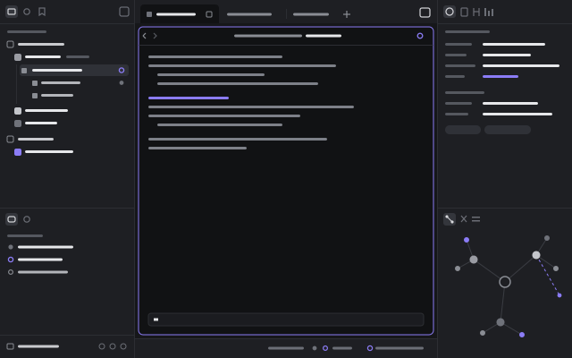

# Vaultr

An Obsidian-style workbench with no system title bar: a center column of tabbed
terminal panes with two-row headers and a compact agent status bar, framed by
collapsible left and right sidebars split into upper and lower panel stacks for
sessions, search, bookmarks, live agents, recent history, plan quotas, terminal
properties, files, changes, usage insights, vault notes, an agent-and-note
relationship graph, and a sub-agent outline.

## What you see

- **Window chrome (`layouts/vaultr.json`)**: `row` root with `titlebar: "none"`,
  macOS `traffic_lights: [12, 14]`, `background: "canvas"`,
  `terminal_padding: [14, 12]`, `1px` `border` dividers, and
  `preview: "layouts/vaultr.svg"`.
- **Left rail (`ob-left`, `300px`, `min: 200`, `max: 640`, `background: "chrome"`,
  `resizable: false`)**:
  - Top stack (`ob-lt`, `weight: 3`, `min: 140`): `40px` `window_drag` strip
    (`ob-lt-strip`: `ob-strip` `{ stack: "ob-lt-stack", side: "left", place: "top" }`)
    over `ob-lt-stack` (active: `ob-sessions`): `ob-sessions`, `ob-search`,
    `ob-bookmarks`.
  - Bottom stack (`ob-lb-stack`, `weight: 2`, `min: 90`, `34px` header `ob-strip`
    `{ stack: "ob-lb-stack", side: "left", place: "bottom" }`, active: `ob-agents`):
    `ob-agents`, `ob-recent`.
  - Footer (`ob-footer`): `40px` bottom strip.
- **Center column (`ob-center`, `resizable: false`)**:
  - Tab bar (`ob-tabbar`, `40px`, `window_drag: true`): `ob-tabs`.
  - Main terminal viewport (`ob-main`, `padding: 6`, `tab: "active"`): panes with
    `gap: 6`, `radius: 6`, `background: "background"`, `1px` `border` (`1px`
    `accent` focus ring), and `56px` always-visible top header (`ob-pane`,
    `lone: true`, split into `30px` controls + `26px` prompt/CWD bar).
  - Status row (`ob-statusrow`, `26px`): `ob-status` (right-aligned attention
    overview, feed scanner alert icon, zoom `%` reset button when zoom is not `100%`).
  - Background feed scanner (`ob-feed-scan`, `0px`): `ob-feed` (`{ role: "scan" }`).
- **Right rail (`ob-right`, `368px`, `min: 240`, `max: 960`,
  `background: "chrome"`)**:
  - Top stack (`ob-rt`, `weight: 3`, `min: 140`): `40px` `window_drag` strip
    (`ob-rt-strip`: `ob-strip` with `windowButtons: true`) over `ob-rt-stack`
    (active: `ob-quotas`): `ob-quotas`, `ob-props`, shipped `files`, shipped
    `changes`, `insights`, and `ob-notes` (`obsidian` `{ view: "panel" }`).
  - Bottom stack (`ob-rb-stack`, `weight: 2`, `min: 90`, `34px` header `ob-strip`
    `{ stack: "ob-rb-stack", side: "right", place: "bottom" }`, active: `ob-graph`):
    `ob-graph`, `ob-outline`.
- **Overlays & Popups**:
  - Quick Switcher (`ob-switcher`): `popup`, `660px` x `72%`, `48px` from top;
    `ObSwitcher` `key_context`; modes: Everything, Views, Commands (`>` or
    `Ctrl+Shift+P`), Move.
  - Settings (`ob-settings`): `dialog`, `900px` x `86%`, centered; `ObSettings`
    `key_context`; tabs: **Vault**, **Feedback** (`feedback.json`),
    **Hotkeys** (with **Layout** sub-tab for window buttons and plain-Ctrl
    give-back), and **Herdr settings…**.
  - Submit feedback (`ob-feedback`): `dialog`, `680px` x `580px`, centered;
    `ObFeedback` `key_context`; `Textarea`/`TextareaState` Markdown input,
    `image("data/ob-feedback/shot-<timestamp>.png")` preview, and bundle export.
  - Notes popup (`obsidian`): `popup`, `760px` x `560px`, `40px` from top (modes:
    name, `/text`, `#tag`, `+text`, `>title`, `Alt+Enter`).
  - Prompt history (`ob-pane`): `dialog`, `680px` x `480px`, `ObPanePrompts`
    `key_context` (`Transcript`, `Copy latest`, per-prompt `Copy`, `Escape` to close).
  - Transcript / Log viewer (`ob-outline`): `popup`, width `760px`; virtualized
    list (`v_virtual_list` + `opacity(0)` measurement, `60`/frame) opening
    scrolled to the bottom.
  - Attach terminal (`ob-outline`): `dialog`, `75%` x `75%`, `36px` header (`ObAttach`
    `key_context`) above interactive terminal (`Escape` detaches until click).
  - Context menu (`ob-menu`): pointer `popup`, `230px` default width (`400px` in
    `mod.json`, dynamic height capped at `560px` in `openMenu`), `ObMenu`
    `key_context`.
  - New tab menu (shipped `new-menu`, opened by `ob-tabs`): `popup`, `250px` x `512px`.

## How it behaves

- **Status marks (`kit/kit.js`)**:
  - `working`: `900ms` spinning ring (`working`).
  - `blocked` ("Needs you"): `1100ms` pulsing solid dot (`blocked`), plus
    `"Needs you"` badge when wide (`>= 220px` in `ob-agents`, `ob-sessions`, and
    `ob-props`; `>= 300px` in `ob-pane`).
  - `done`: solid dot (`done`); `idle`: hollow ring (`idle`); `ok`: checkmark
    (`ansi2`); `failed`: `circle-x` (`blocked`); `stopped`: dim hollow ring
    (`dim`).
- **Attention & stateless rollup (`kit/attention.js`, `kit/hidden.js`)**: A live
  parent terminal with a `working` or `blocked` record whose feed entry has not
  ended counts as `working`/`blocked`. Dismissals (`ob.dismissed`, stamp
  `<word>@<status_ms>#<turn>`) hide entries from attention counters/views only;
  `ob.hidden` hides machines, spaces, and tabs in `ob-sessions`.
- **Provider facade (`kit/provider.js` + `mods/ob-feed/providers/`)**:
  - `index.json` enables `claude`, `pi`, and `antigravity`; `scan_core.py` and
    `reader_main.py` dispatch per-provider modules (`claude/`, `pi/`,
    `antigravity/`) while `makeProvider` exposes `list`, `of`, `sessions`,
    `session`, `subagents`, `transcript`, `usage`, `search`, `quota`, `scan`,
    and `dropCache`.
  - **`ob-feed` (`provider.scan()`)**: polls `2s` live / `15s` idle / `60s`
    retry; `1s` min publish throttle; `60s` heartbeat / `120s` stale threshold;
    `maxAgeH = 48`; `limit = 40`; `TOUCH_CAP = 40` (`TOUCH_TOTAL = 400`);
    `PI_READS = 30`; `LIVE_MS` `90s`; `65536`-byte (`64 KiB`) tail; up to `12`
    recent prompts (`1600`/`160` char caps).
  - **`ob-quotas` (`provider.quota()`, `providers/claude/quota.py`)**: `5m` TTL,
    `60s` retry backoff, `30s` visible poll, `45s` outer timeout (`60s` CLI
    timeout); checks Claude state-folder and binary/wrapper evidence before
    launching a sandboxed usage query (`bwrap` on Linux; `sandbox-exec` +
    stripped credentials copy on macOS).
  - **`ob-props` (`provider.usage()`)**: `10s` visible poll, `32 MiB` transcript
    read cap (skipping unchanged `size` + `mtime_ns`), plus `hc get <addr> --json`.
  - **`ob-search` (`provider.search()`)**: `3 MiB`/file, max `60` files, `200`
    hits/file (`200` total), `6s` scan budget, plus `hc read <addr> --lines 1500`
    cached `15s` (max `6` parallel).
  - **`ob-outline` (`provider.transcript()`)**: `3 MiB` / `250` entries, `4s` live
    refresh (`1.5s` for `tail -n 400` logs), `parent` nesting, `hc run` (Open
    session), and `<prog> --help` `--session` check.
  - **`insights`**: runs `node` (`mods/insights/collector.mjs`, optional
    `runtime.json`) across its five built-in adapters (`pi`, `Codex`,
    `OpenCode`, `Claude Code`, `Antigravity`), enforcing `16 MiB` blob and
    `100_000` protobuf field caps during Antigravity SQLite indexing.
- **Hotkeys (`ob-settings`, `keys/vaultr-keys.json`)**: normalizes chords,
  caches parsed section bindings in a `WeakMap`, merges shipped defaults from
  `keys/vaultr-keys.json` via `install.sh`, and writes user edits to `keys.json`
  in the Herdr app folder (restoring the previous text if `keys.error` appears).

## Built from

- **Kit (`kit/`, synced via `kit/sync.sh`)**: `kit.js`, `provider.js`, `obc.js`
  (`ob-graph`, `ob-outline`, `ob-props`), `agents.js`, `names.js`, `hidden.js`,
  `attention.js`, `follow_target.js`, `feed_age.js`, `feedback_bundle.js`,
  `ticker.js`, `fuzzy.js`, `touches.js`, `lights.js`, `icons/`.
- **Shipped Herdr mods used**: `files`, `changes`, and `new-menu`.
- **Providers (`mods/ob-feed/providers/`)**: `index.json`, `scan_core.py`,
  `reader_main.py`, `claude/` (`manifest.json`, `scan.py`, `reader.py`,
  `quota.py`), `pi/` (`manifest.json`, `scan.py`, `reader.py`), `antigravity/`
  (`manifest.json`, `scan.py`, `reader.py`).
- **`"herdr"` API imports**: `agents`, `appHome`, `checking`, `closeOverlay`,
  `commands`, `exec`, `focused`, `hc`, `home`, `keys`, `layout`, `layouts`,
  `machines`, `nextCommand`, `notify`, `openOverlay`, `panes`, `pickFolder`,
  `props`, `readTextFile`, `run`, `setAgentOrder`, `setShared`, `settings`,
  `shared`, `spaces`, `terminals`, `theme`, `updates`, `watchFolder`, `window`,
  `writeTextFile`.
- **Shared state keys**: `ob.hidden`, `ob.dismissed`, `ob.bookmarks`,
  `ob.subagents` (`v: 2`), `ob.quotas`, `ob.focus`, `ob.follow`, `ob.inspect`,
  `ob.history`, `ob.zen`, `ob.settings`, `ob-settings.tab`, `ob-settings.open`,
  `space.colors`, `obsidian.agent`, `obsidian.viewers`, `obsidian.show`.
- **Theme tokens (`theme()`)**: `background`, `chrome`, `border`, `input`,
  `raised`, `hover`, `selected`, `popover`, `foreground`, `muted`, `dim`,
  `accent`, `accent_foreground`, `working`, `blocked`, `done`, `idle`, `ansi1`,
  `ansi2`, `ansi3`, `ansi4`, `ansi5`, `ansi6`.
- **Key contexts & files**: `keys/vaultr-keys.json` (`layout:vaultr`,
  `mod:ob-sessions`), `$HERDR_APP_HOME/keys.json`, plus `ObFeedback`,
  `ObSwitcher`, `ObSettings`, `ObPanePrompts`, `ObAttach`, and `ObMenu`.
- **External commands & filesystem paths**:
  - `herdr-app` (`shot`, `status`, `ls`), `cp`, `rm`, `python3`, `hc` (`get`, `read`, `run`, `machine ls`, `machine rm`,
    `machine add`), `git`, `node`, `rg` (`find`/`grep` fallback), `tail`,
    `mkdir`, `test` (`test -d`, `test -s`), `sh`, `open`/`xdg-open`/`cmd`,
    `$VISUAL`/`$EDITOR`/`vi`/`notepad`, `herdr-artifact` (`open`), `ps`/`lsof` or
    `/proc`, `nice`, `bwrap` (Linux) / `sandbox-exec` + `security` + `touch`
    (macOS), `true`, `mise which claude`, `claude -p /usage`.
  - Reads `obsidian.json`, `feedback.json`, `keys.json`, `keys.error`,
    `*.error`, `layouts/.state/<layout>.json`, and `mods/worktree/mod.json` in
    the Herdr app folder, stages `data/ob-feedback/` (`shot-<timestamp>.png` and `capture.json`), writes
    `<feedback-folder>/<timestamp>-<slug>/{feedback.md,screenshot.png,ui-tree.json,diagnostics.log}`,
    Obsidian `.obsidian/daily-notes.json` and
    `.obsidian/app.json`, `~/.claude` (or `CLAUDE_CONFIG_DIR`), `~/.claude.json`,
    `~/.claude/projects`, `~/.pi/agent/sessions`, temp
    `pi-subagents-uid-<uid>/async-subagent-runs`, `~/.codex/sessions`,
    `~/.codex/archived_sessions`, `~/.local/share/opencode`,
    `~/.gemini/antigravity-cli` (`presence/`, read-only
    `conversation_summaries.db`, `conversations`, `brain`, and
    `transcript.jsonl`), and `.herdr/artifacts` or `.local/share/shepherdr/artifacts`
    (skipping `danger/` and vault dot-folders).

## Watch out

- **Herdr version**: requires Herdr **`0.1.16`** or newer.
- **Kit sync rule**: edit shared frontend helpers only in `kit/` and run
  `./kit/sync.sh`; mod copies are overwritten on sync.
- **Install vs live changes**: `install.sh` symlinks `mods/` and copies
  `layouts/vaultr.json` unless `--link` is given, while Hotkeys writes user
  binding edits to `keys.json` in the Herdr app folder (`vaultr-keys.owned.json`
  tracks shipped keys). Never edit `~/.config/herdr-app/layouts/.state/`.
- **Shipped Herdr mods**: `files`, `changes`, and `new-menu` are Herdr built-in
  mods and do not live in `mods/`.
- **Provider isolation & Antigravity scope**: keep provider-specific parsing
  inside `mods/ob-feed/providers/<id>/` and register IDs in
  `providers/index.json`; Antigravity supports `title` and `transcript` only and
  is tested against synthetic fixtures rather than a live Antigravity install.
- **Resource & privacy hygiene**: Python file/process/SQLite helpers must close
  handles cleanly (`-W error::ResourceWarning`); never commit personal paths,
  usernames, emails, or hostnames.

## Done when

- `python3 -W error::ResourceWarning -m unittest discover -s test` passes
  completely (~145 s across 930+ tests, zero warnings).
- `layouts/*.json`, `keys/*.json`, and `mods/*/mod.json` validate cleanly with
  `python3 -m json.tool` (matching
  [`.github/workflows/check.yml`](.github/workflows/check.yml)).
- `./kit/sync.sh` leaves zero unstaged kit differences across mods.
- `HERDR_APP_HOME=<tmp> ./install.sh` and `--uninstall` exit cleanly.
- `herdr-app check mods/<name>` (Herdr `0.1.16`+) reports zero errors on every
  mod in `mods/`.
